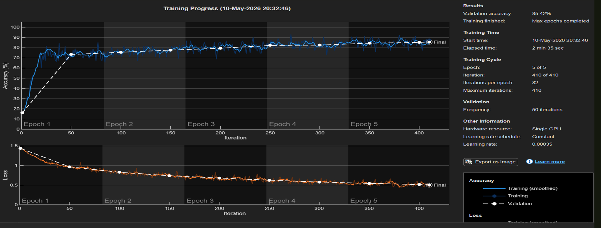
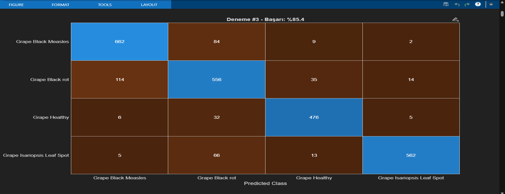
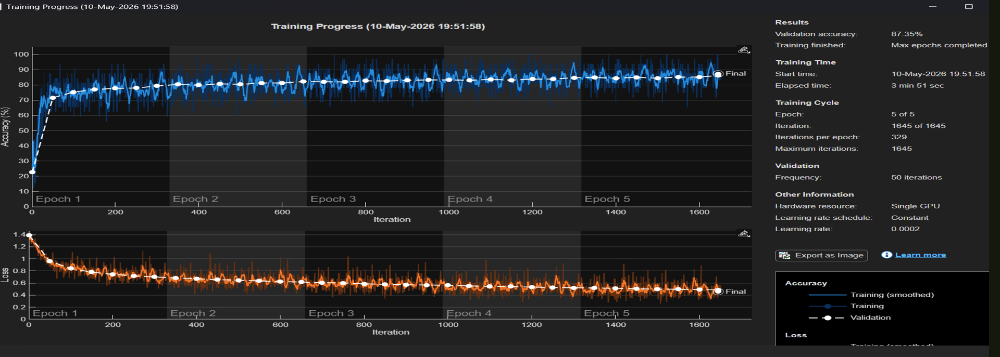
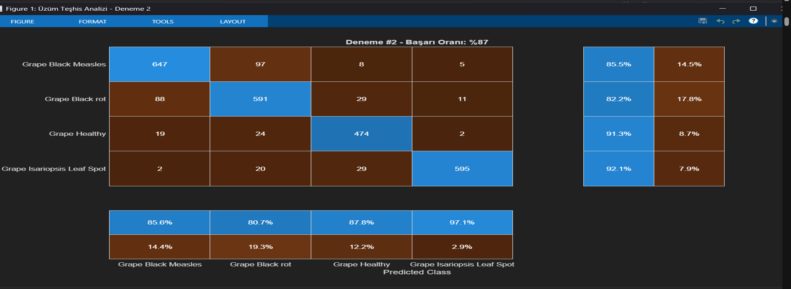

# matlab-bitki-hastaligi-tespiti
# MATLAB ile Derin Öğrenme Tabanlı Bitki Yaprağı Hastalıklarının Sınıflandırılması

## Proje Hakkında
Bu proje, MATLAB ortamında Evrişimsel Sinir Ağları (CNN) kullanılarak bitki yapraklarındaki hastalık belirtilerinin görüntüler üzerinden sınıflandırılmasına yönelik akademik bir çalışmadır.

## Projenin Amacı
Derin öğrenme teknikleri kullanarak bitki yaprağı görüntülerini analiz edebilen ve dört farklı sınıfa ayırabilen bir model geliştirmek, farklı model mimarilerinin sınıflandırma performansını incelemek.

## Kullanılan Teknolojiler
- MATLAB
- Deep Learning Toolbox
- Convolutional Neural Networks (CNN)
- Görüntü İşleme
- Veri Ön İşleme ve Model Optimizasyonu

## Gerçekleştirilen Çalışmalar
- CNN tabanlı görüntü sınıflandırma mimarilerinin oluşturulması
- Eğitim ve doğrulama verilerinin ayrılması
- Öğrenme hızı, epoch sayısı ve katman parametrelerinin değiştirilmesi
- Farklı model yapılandırmalarının karşılaştırılması
- Eğitim sonuçlarının ve karmaşıklık matrislerinin incelenmesi

## Proje Kapsamı
Akademik çalışma kapsamında farklı model yapılandırmaları üzerinde çok sayıda deneme belgelenmiştir. Çalışma, derin öğrenme modellerinin eğitimi ve performans değerlendirmesi üzerine uygulamalı deneyim kazanılmasını amaçlamaktadır.
## Proje Görselleri

### Deneme 03 – Eğitim Grafiği

### Deneme 03 – Karışıklık Matrisi

### Deneme 04 – Eğitim Grafiği

### Deneme 04 – Karışıklık Matrisi

